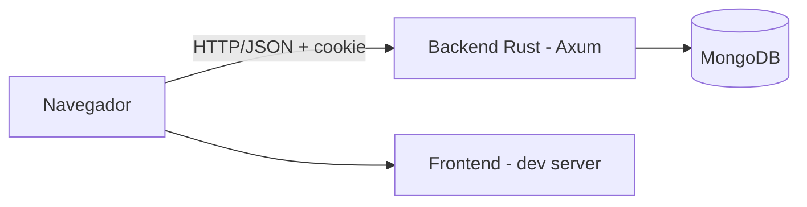

# Spec — Whiteboard de System Design

*Versão 0.2 · 10/11/2026 · Autor: Luiz · Status: rascunho para revisão*

## 1. Visão geral

### 1.1 Problema

Ferramentas de whiteboard genéricas (Excalidraw, Miro) exigem que o usuário desenhe do zero cada caixa de banco de dados, servidor ou cliente. Para quem desenha arquitetura de software com frequência, isso é lento e inconsistente, e a organização dos quadros costuma ser fraca (tudo solto, sem busca nem agrupamento).

### 1.2 Proposta

Um whiteboard de canvas infinito, estilo Excalidraw, com **componentes nativos de TI** (database, server, client, mobile, laptop etc.) e uma **organização de quadros de primeira classe**: grupos, tags, busca, favoritos e lixeira.

### 1.3 Público-alvo

Desenvolvedores, arquitetos e estudantes que desenham diagramas de system design no dia a dia.

### 1.4 Diferenciais

1. Biblioteca de componentes de TI nativos, estilizáveis (cor, opacidade, efeitos).
2. Organização e navegação dos próprios quadros (grupos, tags, busca, favoritos, recentes).
3. Setas ligadas a elementos que acompanham o movimento.

### 1.5 Fora de escopo (por enquanto)

Colaboração em tempo real, deploy em produção, templates prontos, aplicativo nativo mobile e importação de formatos de terceiros (Excalidraw, draw.io). Ver roadmap (seção 12).

### 1.6 Premissas

- Execução **somente local**, com containers Docker de desenvolvimento para frontend, backend e banco.
- Backend em **Rust**, banco **NoSQL (MongoDB)**.
- Autenticação por **JWT**, com **refresh token gerenciado pelo backend**.
- Frontend em **React + Vite** com **motor de canvas próprio em Canvas 2D** (React apenas para a UI ao redor do canvas) e **shadcn/ui** (ADR-001, seção 8.3).
- Uso previsto: **poucos usuários, possivelmente apenas um**. Isso não muda o isolamento por usuário, mas dispensa otimizações de escala.

## 2. Glossário

- **Quadro (board):** documento de desenho com canvas infinito.
- **Grupo:** pasta/coleção que organiza quadros.
- **Tag:** rótulo livre associado a um quadro, para filtro e busca.
- **Elemento:** qualquer objeto no canvas (forma, seta, texto, desenho, componente).
- **Componente de TI:** elemento pré-pronto que representa uma peça de arquitetura (database, server etc.).
- **Cena (scene):** conteúdo de um quadro: lista de elementos mais estado de visualização.
- **Binding:** ligação de uma extremidade de seta a um elemento.
- **Viewport:** região visível do canvas, definida por posição (x, y) e zoom.

Prioridades: **P0** = MVP, **P1** = fase seguinte, **P2** = futuro.

## 3. Requisitos funcionais

### 3.1 Conta e autenticação

| ID | Requisito | Prio |
| --- | --- | --- |
| RF-A01 | Usuário pode se cadastrar com **username único** e senha | P0 |
| RF-A02 | Usuário pode fazer login e logout | P0 |
| RF-A03 | Sessão é renovada automaticamente via refresh token, sem novo login | P0 |
| RF-A04 | Usuário só acessa seus próprios grupos e quadros | P0 |
| RF-A05 | Usuário pode encerrar a sessão em todos os dispositivos | P1 |
| RF-A06 | Usuário pode alterar a senha | P1 |

### 3.2 Quadros

| ID | Requisito | Prio |
| --- | --- | --- |
| RF-Q01 | Criar quadro (grupo opcional). O **título é obrigatório apenas no backend**; o frontend gera um nome padrão sequencial (ex.: `Quadro-1`, `Quadro-2`) e o envia na criação | P0 |`n| RF-Q01a | O usuário pode alterar o nome padrão depois (ver RF-Q04) | P0 |
| RF-Q02 | Listar quadros do usuário | P0 |
| RF-Q03 | Abrir um quadro e restaurar cena e viewport | P0 |
| RF-Q04 | Renomear quadro | P0 |
| RF-Q05 | Deletar quadro (vai para a lixeira) | P0 |
| RF-Q06 | Restaurar quadro da lixeira; excluir definitivamente; esvaziar lixeira | P1 |
| RF-Q07 | Duplicar quadro | P1 |
| RF-Q08 | Mover quadro entre grupos | P0 |
| RF-Q09 | Miniatura (thumbnail) do quadro na listagem | P1 |
| RF-Q10 | Autosave: alterações são salvas automaticamente, com indicador de estado (salvo, salvando, erro) | P0 |
| RF-Q11 | Histórico de versões do quadro, com restauração de uma versão anterior | P1 |
| RF-Q12 | Compartilhar quadro por link (leitura ou edição) | P2 |

### 3.3 Organização e navegação (diferencial)

| ID | Requisito | Prio |
| --- | --- | --- |
| RF-O01 | Criar, renomear e deletar grupos de quadros | P0 |
| RF-O02 | Listar quadros por grupo; existe a visão "Sem grupo" | P0 |
| RF-O03 | Adicionar e remover tags em um quadro | P0 |
| RF-O04 | Filtrar quadros por uma ou mais tags | P0 |
| RF-O05 | Buscar quadros por título e tags | P0 |
| RF-O06 | Ordenar por nome, data de criação, última edição | P0 |
| RF-O07 | Marcar quadros como favoritos e ter uma visão de favoritos | P1 |
| RF-O08 | Visão de recentes (últimos quadros abertos) | P1 |
| RF-O09 | Visualização em grade (com thumbnail) e em lista | P1 |
| RF-O10 | Grupos aninhados (subgrupos) | P2 |
| RF-O11 | Busca por texto dentro do conteúdo dos quadros | P2 |
| RF-O12 | Ações em lote (mover, tagar, deletar vários quadros) | P2 |

Regra proposta para deleção de grupo: ao deletar, o usuário escolhe entre **mover os quadros para "Sem grupo"** (padrão) ou **enviá-los para a lixeira**.

### 3.4 Canvas e navegação

| ID | Requisito | Prio |
| --- | --- | --- |
| RF-C01 | Canvas infinito | P0 |
| RF-C02 | Zoom in/out pela **roda do mouse (sem Ctrl)**, pinça, botões e atalhos (`+`, `-`), com limites de **10% a 800%**; o zoom é centrado no cursor (ou no centro da tela nos botões/atalhos) | P0 |
| RF-C03 | Mover-se livremente em qualquer direção (inclusive "para baixo") **arrastando com a ferramenta mão** ou **espaço+arrastar**; botão do meio do mouse também arrasta. A roda do mouse **não** faz pan (ela faz zoom) | P0 |
| RF-C04 | "Ajustar à tela" e "voltar a 100%" | P1 |
| RF-C05 | Grade opcional e **snap** à grade e a outros elementos (guias de alinhamento) | P1 |
| RF-C06 | Minimapa | P2 |
| RF-C07 | Suporte a touch/caneta (pan, pinça, desenho) | P1 |

### 3.5 Elementos

| ID | Requisito | Prio |
| --- | --- | --- |
| RF-E01 | Adicionar formas geométricas: retângulo, elipse, losango, triângulo, linha | P0 |
| RF-E02 | Adicionar setas (reta; curva e ortogonal em P1), com ponta configurável | P0 |
| RF-E03 | Adicionar **componentes de TI** da biblioteca nativa (seção 7) | P0 |
| RF-E04 | Adicionar e editar textos (duplo clique para editar; texto dentro de formas e componentes em P1) | P0 |
| RF-E05 | Desenho à mão livre com suavização | P0 |
| RF-E06 | Ligar elementos por setas (bindings) com recálculo ao mover/redimensionar | P0 |
| RF-E07 | Deletar qualquer elemento (Delete/Backspace); ao deletar um elemento, setas ligadas a ele ficam soltas na ponta | P0 |
| RF-E08 | Selecionar um elemento; seleção múltipla (Shift, caixa de seleção) | P0 |
| RF-E09 | Mover, redimensionar e **rotacionar** elementos | P0 |
| RF-E10 | Copiar, colar, duplicar (inclusive entre quadros) | P1 |
| RF-E11 | Agrupar/desagrupar elementos | P1 |
| RF-E12 | Ordem de camadas (trazer para frente, enviar para trás) | P1 |
| RF-E13 | Bloquear elemento (não editável) | P2 |
| RF-E14 | Borracha | P2 |

### 3.6 Edição e produtividade

| ID | Requisito | Prio |
| --- | --- | --- |
| RF-P01 | **Undo/redo** ilimitado dentro da sessão | P0 |
| RF-P02 | Atalhos de teclado para ferramentas e ações, com painel de ajuda | P1 |
| RF-P03 | Exportar quadro (ou seleção) em **PNG** e **SVG** (com fundo opcional e escala) | P1 |
| RF-P04 | Exportar e importar quadro em **JSON** (formato versionado) | P1 |
| RF-P05 | Busca e inserção rápida de componentes (paleta de comandos) | P2 |

## 4. Requisitos não funcionais

### 4.1 Aparência e estilo

| ID | Requisito | Prio |
| --- | --- | --- |
| RNF-S00 | Visual **extremamente simples e minimalista**, usando componentes **shadcn/ui** (Tailwind + Radix); sem customização visual elaborada | P0 |
| RNF-S01 | Modo claro e escuro, respeitando a preferência do sistema e com escolha manual persistida | P0 |
| RNF-S02 | Cor de contorno configurável para todos os tipos de elemento | P0 |
| RNF-S03 | Cor de preenchimento, espessura e estilo do traço (sólido, tracejado, pontilhado) | P0 |
| RNF-S04 | Fonte: família (ex.: manuscrita, sans-serif, monoespaçada), tamanho e alinhamento (esq., centro, dir.) | P0 |
| RNF-S05 | **Efeitos** por elemento: neon (brilho colorido), blur, sombra; com intensidade ajustável | P1 |
| RNF-S06 | Opacidade de 0 a 100% por elemento | P0 |
| RNF-S07 | Cores que se adaptam ao tema (elementos com cor "automática" invertem entre claro e escuro) | P1 |

### 4.2 Desempenho

- 60 fps em pan e zoom com 2.000 elementos simples em um notebook comum.
- Renderizar apenas o que está no viewport (culling) e usar índice espacial para hit-testing.
- Abrir um quadro com 2.000 elementos em menos de 1 s (ambiente local).
- Latência de resposta da API abaixo de 100 ms (p95) nas operações de CRUD, em ambiente local.

### 4.3 Persistência e confiabilidade

- Autosave com debounce de 1 a 2 s, mais salvamento ao perder o foco e ao fechar a aba.
- **Controle de concorrência otimista**: cada cena tem um `revision`; salvar com revisão desatualizada retorna conflito (409), evitando sobrescrever edições feitas em outra aba.
- Em falha de rede, manter alterações em memória e tentar novamente, mostrando o estado ao usuário.
- Formato da cena com `schemaVersion` e migrações.

### 4.4 Segurança

- Senhas com **Argon2id**.
- Validação de entrada em todas as rotas; limite de tamanho do corpo (cena).
- Isolamento por usuário em toda consulta (filtro por `ownerId`), sem confiar em IDs vindos do cliente.
- Rate limiting em login e refresh.
- CORS restrito à origem do frontend, com credenciais habilitadas.
- SVGs dos componentes sanitizados (sem scripts); sem `innerHTML` com conteúdo do usuário.
- Segredos fora do repositório (`.env`), com `.env.example` versionado.

### 4.5 Usabilidade e acessibilidade

- Navegação por teclado nas telas de listagem e nos menus; foco visível; contraste AA nos dois temas.
- Interface responsiva nas telas de listagem; o editor de canvas é otimizado para desktop e tablet.
- Idioma da interface: pt-BR (estrutura preparada para i18n).

### 4.6 Manutenibilidade e observabilidade

- Logs estruturados (`tracing`) com ID de requisição.
- Endpoint de saúde (`/health`) e de prontidão (`/ready`).
- Testes automatizados (seção 11) e CI no GitHub Actions.
- Documentação da API em OpenAPI.

## 5. Autenticação (JWT + refresh token no backend)

### 5.1 Fluxo

1. **Login/registro:** backend valida credenciais e responde com o **access token** (JWT) no corpo e o **refresh token** em cookie.
2. **Requisições:** o frontend envia `Authorization: Bearer <access>`; o access token fica **apenas em memória** (não em localStorage).
3. **Expiração:** ao receber 401, o frontend chama `POST /auth/refresh` (o cookie vai automaticamente), recebe um novo access token e repete a requisição uma vez.
4. **Recarregar a página:** o frontend chama `/auth/refresh` na inicialização para recuperar a sessão.
5. **Logout:** o backend revoga o refresh token e limpa o cookie.

### 5.2 Access token

- JWT assinado (HS256 em dev; considerar EdDSA/RS256 depois), validade de **15 minutos**.
- Claims: `sub` (userId), `iat`, `exp`, `jti`.

### 5.3 Refresh token

- **Token opaco** (aleatório, 256 bits), não JWT. O backend guarda apenas o **hash** (SHA-256) no MongoDB.
- Cookie `HttpOnly`, `SameSite=Strict`, `Path=/auth`, `Secure` (desligado apenas em `localhost` por HTTP).
- Validade de 7 dias, com **rotação a cada uso**: o token antigo é invalidado e um novo é emitido.
- **Detecção de reuso:** se um token já rotacionado for apresentado de novo, toda a **família** de tokens daquela sessão é revogada e o usuário precisa logar novamente.
- Índice TTL no MongoDB para limpeza automática de tokens expirados.

### 5.4 Endpoints

| Método | Rota | Descrição |
| --- | --- | --- |
| POST | `/auth/register` | Cria conta |
| POST | `/auth/login` | Autentica; devolve access token e define cookie |
| POST | `/auth/refresh` | Rotaciona refresh token e devolve novo access token |
| POST | `/auth/logout` | Revoga o refresh token atual |
| POST | `/auth/logout-all` | Revoga todas as sessões (P1) |
| GET | `/auth/me` | Dados do usuário autenticado |

## 6. Modelo de dados (MongoDB)

### 6.1 Coleções

| Coleção | Conteúdo | Índices principais |
| --- | --- | --- |
| `users` | `_id`, `username`, `passwordHash`, `preferences` (tema, idioma), `createdAt` | `username` único |
| `refresh_tokens` | `_id`, `userId`, `familyId`, `tokenHash`, `expiresAt`, `revokedAt`, `replacedBy`, `userAgent`, `createdAt` | `tokenHash` único; `userId`; TTL em `expiresAt` |
| `groups` | `_id`, `ownerId`, `name`, `parentId` (reservado para P2), `createdAt` | `ownerId` + `name` |
| `boards` | `_id`, `ownerId`, `groupId` (nulo = sem grupo), `title`, `tags[]`, `isFavorite`, `thumbnail`, `deletedAt`, `lastOpenedAt`, `createdAt`, `updatedAt` | `ownerId` + `groupId`; `ownerId` + `tags`; texto em `title` e `tags`; `ownerId` + `deletedAt` |
| `board_scenes` | `_id` (= boardId), `schemaVersion`, `revision`, `elements[]`, `viewport`, `updatedAt` | `_id` |
| `board_versions` | `_id`, `boardId`, `revision`, `elements[]`, `createdAt` | `boardId` + `createdAt` |
| `component_library` | `_id`, `key`, `name`, `category`, `svg`, `defaultSize`, `version` | `key` único |

**Por que separar `boards` de `board_scenes`:** a listagem só precisa dos metadados; a cena pode ser grande (o limite de documento do MongoDB é 16 MB) e é carregada apenas ao abrir o quadro.

**Histórico de versões (P1):** um snapshot é gravado em `board_versions` em intervalos (ex.: no máximo 1 a cada 5 minutos de edição ou ao fechar o quadro), mantendo as últimas N versões.

### 6.2 Esquema de elemento

Todo elemento tem os campos comuns:

```json
{
  "id": "uuid",
  "type": "rectangle | ellipse | diamond | triangle | line | arrow | text | freehand | component",
  "x": 0, "y": 0, "width": 120, "height": 80,
  "rotation": 0,
  "zIndex": 10,
  "groupIds": [],
  "locked": false,
  "style": {
    "strokeColor": "#1e1e1e",
    "fillColor": "transparent",
    "strokeWidth": 2,
    "strokeStyle": "solid | dashed | dotted",
    "opacity": 100,
    "effect": { "type": "none | neon | blur | shadow", "intensity": 50, "color": "#00ffff" }
  },
  "version": 1
}
```

Campos específicos por tipo:

- **text:** `text`, `fontFamily`, `fontSize`, `textAlign`.
- **arrow / line:** `points[]` (relativos), `startBinding`, `endBinding` (`{ elementId, anchor }`), `startArrowhead`, `endArrowhead`, `routing` (`straight | curved | orthogonal`).
- **freehand:** `points[]` com pressão opcional.
- **component:** `componentKey` (ex.: `database`), `label`.

IDs são estáveis (UUID), sem referência posicional. Isso facilita bindings, undo/redo e uma futura colaboração com CRDT.

## 7. Biblioteca de componentes de TI

### 7.1 Catálogo inicial (P0)

- **Clientes:** Browser/Web client, Mobile device, Laptop/Desktop, Usuário.
- **Backend:** Server, Microservice, Worker/Job, API Gateway, Load Balancer.
- **Dados:** Database (SQL), Database (NoSQL), Cache, Object Storage.
- **Mensageria:** Message Queue, Event Stream.
- **Infra/rede:** Cloud, CDN, Firewall, Container, Kubernetes.
- **Outros (P1):** Serviço externo, E-mail/Notificação, Monitoramento, Search engine, DNS, Autenticação.

### 7.2 Formato

- SVG simples, com `viewBox` fixo (ex.: 64×64), traço baseado em `currentColor`, para aceitar cor de contorno, opacidade e efeitos sem duplicar arquivos.
- Cada componente tem `key`, `name`, `category`, `defaultSize` e pontos de ancoragem para as setas.
- Os componentes são versionados e servidos pelo backend (`GET /components`), podendo ser embutidos no frontend como fallback.
- Rótulo editável embaixo do ícone (texto do componente).

## 8. Arquitetura

### 8.1 Visão geral



### 8.2 Backend (Rust)

- **Axum** + Tokio; `serde` para JSON; driver oficial `mongodb`.
- Bibliotecas sugeridas: `jsonwebtoken`, `argon2`, `tower-http` (CORS, limites, tracing), `validator`, `utoipa` (OpenAPI), `uuid`, `thiserror`.
- Organização em camadas: `routes` (HTTP) → `services` (regras) → `repositories` (MongoDB); modelos de domínio separados dos DTOs.
- Configuração por variáveis de ambiente.

### 8.3 Frontend (decidido)

**ADR-001 (aceita):** **React + Vite** com um **motor de canvas próprio em Canvas 2D** (React só para a UI ao redor: barras, painéis, diálogos, listagem), UI com **shadcn/ui**, estado em **Zustand**, `perfect-freehand` para mão livre e `rbush` para índice espacial.

Alternativas consideradas: Konva/react-konva (mais rápido de começar, menos controle), SVG/DOM (simples, mas piora com muitos elementos), PixiJS/WebGL (performance máxima, complexidade maior) e partir do Excalidraw (MIT) ou tldraw (licença com restrições) como base.

Justificativa: o editor é totalmente client-side e fica atrás de login, então SSR não traz ganho; Next.js foi descartado.

**Pontos de arquitetura do editor:**

- Viewport como transformação (x, y, zoom) aplicada na renderização; zoom limitado a 0,1–8 (10%–800%) e ancorado no ponto do cursor; roda/pinça tratadas no motor (`wheel` com `preventDefault`, listener não passivo).
- Pan por ferramenta mão, espaço+arrastar ou botão do meio, via Pointer Events.
- Nome padrão de quadro: o frontend calcula `Quadro-N` com N = maior número já usado em títulos `Quadro-<n>` do usuário (inclui lixeira) + 1.
- Cena como lista de elementos com ID; renderização por camadas (grade, elementos, seleção/handles).
- **Undo/redo** por histórico de patches (ou comandos), registrado a cada interação concluída.
- Recalculo de bindings de setas a cada movimento de elemento ligado.
- Efeitos aplicados no render (Canvas 2D: `shadowBlur`, `filter`).

### 8.4 Ambiente local (Docker)

`docker-compose.yml` de desenvolvimento com três serviços:

| Serviço | Descrição | Porta |
| --- | --- | --- |
| `frontend` | Dev server com hot reload, código montado por volume | 3000 |
| `backend` | Rust com `cargo-watch` (rebuild automático); volume de cache do `cargo` e do `target` | 8080 |
| `mongo` | MongoDB com volume persistente e healthcheck | 27017 |

Detalhes:

- Rede interna única; o backend depende do `mongo` saudável (`depends_on` com `condition: service_healthy`).
- Variáveis em `.env` (`MONGO_URL`, `JWT_SECRET`, `FRONTEND_ORIGIN`, tempos de expiração).
- Opcional: `mongo-express` ou Mongo Compass para inspeção.
- Script de **seed** para popular a `component_library` na primeira subida.
- `Makefile` ou scripts com atalhos (`make up`, `make down`, `make test`, `make seed`).

## 9. API REST (rascunho)

Todas as rotas, exceto `/auth/register`, `/auth/login`, `/auth/refresh` e `/health`, exigem access token.

### 9.1 Grupos

| Método | Rota | Descrição |
| --- | --- | --- |
| GET | `/groups` | Lista grupos do usuário (com contagem de quadros) |
| POST | `/groups` | Cria grupo |
| PATCH | `/groups/:id` | Renomeia |
| DELETE | `/groups/:id?boards=move\|trash` | Deleta grupo e decide o destino dos quadros |

### 9.2 Quadros

| Método | Rota | Descrição |
| --- | --- | --- |
| GET | `/boards` | Lista com filtros: `groupId`, `tags`, `q`, `favorite`, `trash`, `sort`, paginação por cursor |
| POST | `/boards` | Cria quadro; `title` obrigatório (validado no backend, 1–120 caracteres), enviado pelo frontend com o nome padrão sequencial |
| GET | `/boards/:id` | Metadados |
| PATCH | `/boards/:id` | Título, grupo, tags, favorito |
| DELETE | `/boards/:id` | Envia para a lixeira |
| POST | `/boards/:id/restore` | Restaura da lixeira |
| DELETE | `/boards/:id/permanent` | Exclui definitivamente |
| POST | `/boards/:id/duplicate` | Duplica |
| GET | `/boards/:id/scene` | Cena completa |
| PUT | `/boards/:id/scene` | Salva a cena; exige `revision` atual, retorna 409 se desatualizada |
| GET | `/boards/:id/versions` | Lista versões (P1) |
| POST | `/boards/:id/versions/:versionId/restore` | Restaura versão (P1) |

### 9.3 Outros

| Método | Rota | Descrição |
| --- | --- | --- |
| GET | `/tags` | Tags do usuário com contagem de uso |
| GET | `/components` | Catálogo de componentes de TI |
| GET/PATCH | `/me/preferences` | Tema, idioma |

### 9.4 Convenções

- JSON em `camelCase`; datas em ISO 8601 UTC.
- Erros padronizados: `{ "error": { "code": "...", "message": "...", "details": [] } }`.
- Paginação por cursor na listagem de quadros.
- Prefixo de versão (`/api/v1`) a definir.

## 10. Telas

1. **Login / Cadastro** (username e senha).
2. **Biblioteca de quadros:** barra lateral com grupos, favoritos, recentes, tags e lixeira; área principal com grade/lista; busca e ordenação no topo; ações de criar, renomear, mover, tagar, duplicar e deletar.
3. **Editor:** título editável (ex.: `Quadro-1`), barra de ferramentas (seleção, mão, formas, seta, texto, mão livre, componentes), painel de propriedades (cor, espessura, opacidade, efeitos, fonte), controles de zoom, indicador de salvamento, undo/redo, menu de exportação, alternância de tema.
4. **Configurações:** tema, conta, sessões.

## 11. Estratégia de testes

- **Backend:** testes unitários dos serviços; testes de integração das rotas com MongoDB em container (`testcontainers` ou serviço do compose); testes específicos de rotação e reuso de refresh token.
- **Frontend:** testes unitários do motor (transformações de viewport, hit-testing, bindings, undo/redo); testes de componente; **E2E com Playwright** nos fluxos críticos (login, criar quadro, desenhar, salvar, reabrir).
- **Performance:** cena de teste com 2.000 elementos para medir o fps.
- **CI (GitHub Actions):** lint, formatação, testes, `cargo audit` e varredura de imagens com Trivy.

## 12. Roadmap

| Fase | Entrega |
| --- | --- |
| **0 — Fundação** | Repositório, `docker-compose`, esqueleto do backend e do frontend, CI, autenticação completa (registro, login, refresh com rotação, logout) |
| **1 — Núcleo do canvas** | Canvas infinito, pan/zoom, formas, seleção, mover/redimensionar/rotacionar, deletar, undo/redo, tema claro/escuro |
| **2 — Diagramas** | Setas com bindings, texto, componentes de TI, estilos (cor, fonte, opacidade), mão livre |
| **3 — Quadros e organização** | CRUD de quadros e grupos, tags, busca, ordenação, autosave com controle de revisão |
| **4 — Qualidade de vida** | Efeitos (neon, blur), snap/grade, copiar/colar, agrupar, camadas, atalhos, exportação PNG/SVG/JSON, lixeira, favoritos, recentes, thumbnails, histórico de versões |
| **5 — Futuro** | Compartilhamento por link, colaboração em tempo real (CRDT), subgrupos, busca no conteúdo, templates, deploy |

## 13. Riscos e pontos de atenção

| Risco | Mitigação |
| --- | --- |
| Complexidade dos bindings e do roteamento de setas | Começar com setas retas; roteamento curvo e ortogonal em fase posterior |
| Performance do canvas com muitos elementos | Culling, índice espacial, cache de renderização de elementos estáticos; testes com cenas grandes desde cedo |
| Cena grande demais para um documento | Limite de tamanho e, se necessário, dividir a cena em blocos |
| Perda de dados no autosave | Controle por `revision`, retry e persistência local temporária |
| Efeitos (blur/neon) custosos em muitos elementos | Cache em offscreen canvas; limitar o uso por elemento |
| Pan/zoom do canvas próprio com sensação ruim (roda vira zoom; trackpad pode confundir) | Protótipo de pan/zoom/hit-testing de 1 a 2 dias antes da Fase 1; tratar pinça de trackpad (`wheel` com `ctrlKey`) como zoom |

## 14. Decisões em aberto

1. ~~**Frontend:** Canvas próprio vs. Konva; Vite vs. Next.js~~ — **Resolvido:** Canvas 2D próprio, Vite + React, shadcn/ui (ADR-001).
2. **Deleção de grupo:** confirmar o comportamento padrão proposto (mover quadros para "Sem grupo").
3. **Lixeira:** retenção de 30 dias com limpeza automática, ou manual apenas?
4. **Tags:** livres por quadro (proposto) ou cadastradas previamente, com cor?
5. **Grupos:** nível único no MVP (proposto) ou aninhados desde o início?
6. **Idiomas:** apenas pt-BR ou pt-BR e inglês desde o começo?
7. **Algoritmo do JWT:** HS256 em dev e migração para chave assimétrica depois, ou já assimétrico?
