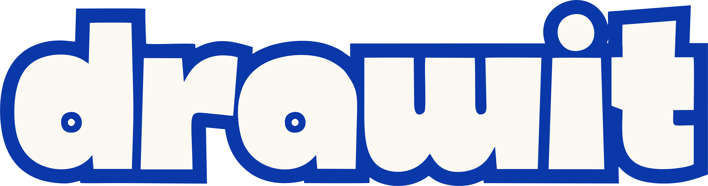
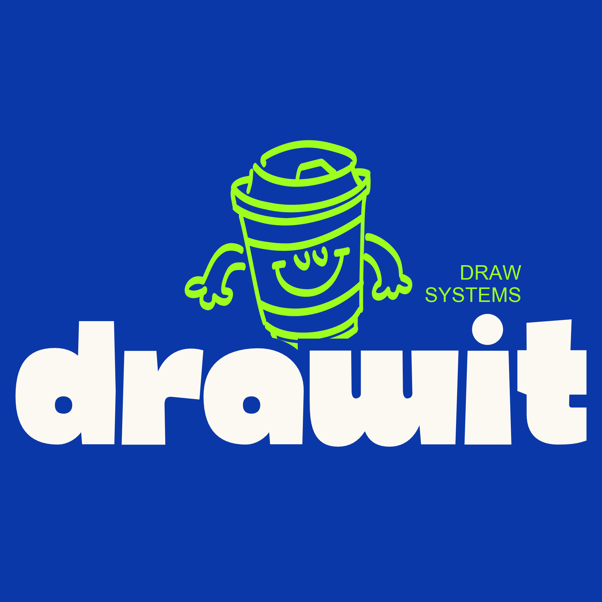

<p align="center">
  <a href="#readme">
    
    <br />
    
  </a>
</p>

<p align="center">
  <strong>The modern open-source infinite canvas crafted specifically for software architecture & system design.</strong>
</p>

<p align="center">
  <a href="https://github.com/luis-felipe/drawit/actions"></a>
  <a href="https://www.rust-lang.org/"></a>
  <a href="https://react.dev/"></a>
  <a href="https://bun.sh/"></a>
  <a href="https://pnpm.io/"></a>
  <a href="https://nginx.org/"></a>
  <a href="https://www.mongodb.com/"></a>
  <a href="https://www.rabbitmq.com/"></a>
  <a href="LICENSE"></a>
</p>

<p align="center">
  <a href="#-why-drawit">Why DrawIt?</a> •
  <a href="#-key-features">Key Features</a> •
  <a href="#-quickstart">Get Started</a> •
  <a href="#-keyboard-shortcuts">Shortcuts</a> •
  <a href="#-contributing--development">Contributing</a> •
  <a href="#-license">License</a>
</p>

---

## 💡 Why DrawIt?

Generic whiteboard applications (Excalidraw, Miro, Figma) are designed for freeform sketching, but fall short when designing distributed systems and complex software architectures:

- ❌ **Repetitive & Slow:** You waste time drawing generic cylinders for databases, manual boxes for microservices, and searching for icons one by one.
- ❌ **Fragile Connectors:** Arrows break and detach whenever components are moved or resized, requiring constant manual reconnection.
- ❌ **Messy Workspaces:** Diagrams pile up in flat, unorganized lists without folders, tags, or search capabilities.
- ❌ **SaaS Paywalls & Privacy Risks:** Basic organizational features and unlimited exports are locked behind expensive subscriptions, requiring you to host your internal infrastructure blueprints on third-party clouds.

**DrawIt solves this.** It gives engineers, software architects, and tech leads a distraction-free, 100% self-hostable whiteboard with **native system design stencils**, **magnetic arrow bindings**, and **structured board organization** out of the box.

<p align="center">
  
</p>

---

## ✨ Key Features

### ⚡ Infinite Canvas Engine
- **Buttery-Smooth 60fps Performance:** Proprietary Canvas 2D engine decoupled from React re-renders for fluid interaction.
- **R-Tree Spatial Indexing:** Powered by `rbush` for instant hit-testing, marquee selection, and rapid rendering on complex diagrams with thousands of components.
- **Fluid Navigation:** Natural mouse wheel zoom (**10% to 800%**) anchored to cursor, Space+Drag panning, and fit-to-screen shortcuts.
- **Organic Freehand Drawing:** Pressure-simulated pen strokes with velocity smoothing powered by `perfect-freehand`.

### 🧩 Native Architecture Stencils
Instant, standardized vector components ready to drop directly into your diagrams:
- **Clients & Frontends:** Web Browser, Mobile App, Desktop Client, Terminal / CLI.
- **Backend & Compute:** API Gateway, Microservice, Background Worker, Load Balancer.
- **Databases & Storage:** Relational Database (SQL), Document DB (NoSQL), In-Memory Cache (Redis), Object Storage (S3).
- **Messaging & Event Streaming:** RabbitMQ Broker, Event Bus / Kafka, Message Queues.
- **Cloud & Infrastructure:** Cloud VPC, Docker Container, Kubernetes Cluster, Firewall / WAF, CDN.

### 🧲 Magnetic Connectors & Dynamic Anchors
- Arrows automatically snap to element anchor ports (North, South, East, West).
- Moving, resizing, or rotating connected stencils updates connector lines in real time without manual re-routing.
- Customizable arrowheads (solid, open, bidirectional, orthogonal).

### 📁 Workspace & Project Organization
- **Hierarchical Groups:** Categorize architecture diagrams into folders (e.g., *Core Backend*, *Payment Gateway*, *Auth Migration*).
- **Tagging & Instant Filtering:** Multi-tag system with fuzzy search across titles and tags.
- **Board Grid Preview:** Visual snapshot cards and last-modified metrics for rapid identification.
- **Favorites & Soft-Delete Trash:** Pin mission-critical blueprints and safely recover archived work.

### 💾 Offline-First Autosave & Conflict Prevention
- **Background Sync:** Automatic continuous saving with real-time sync indicators (*Saved*, *Saving*, *Offline*).
- **IndexedDB Resilience:** Local caching ensures uninterrupted diagramming even during network outages.
- **Optimistic Concurrency:** Smart revision tracking prevents lost updates during collaborative editing.

### 🎨 High-Fidelity Vector & Image Export
- Export diagrams or selected regions to **retina-ready PNG** (2x / 3x scaling) and **pure SVG**.
- Export and import boards as versioned **JSON** schemas for version control, backups, and team sharing.

### 🔐 Robust Authentication & Security
- **Email Verification Flow:** Asynchronous email dispatch via RabbitMQ and SMTP with SHA-256 hashed single-use tokens and 90-second resend cooldowns.
- **Password Reset & Recovery:** Secure forgot-password flow with time-limited tokens and automated email delivery.
- **Strict Password Complexity Policy:** Enforces 5 rules (min. 8 characters, uppercase, lowercase, number, special character) validated synchronously on backend and frontend with real-time UI feedback.
- **Session Security:** Argon2id password hashing, short-lived JWT access tokens with rolling refresh tokens, and instant multi-device revocation.
- **RFC 7807 Problem Details:** Standardized error contracts across all authentication and API endpoints.

### 🔒 Enterprise Privacy & Complete Self-Hosting
- Keep your proprietary system architecture and infrastructure topology on your own servers.
- **Unified Nginx Reverse Proxy:** Single entry point (`http://localhost`) seamlessly routing frontend SPA, backend API endpoints, WebSocket connections, and MailHog without CORS friction.
- Ready to deploy with a single Docker Compose command.

---

## 🚀 Quickstart

Run DrawIt on your local machine or server in under **2 minutes** using Docker Compose.

### 1. Clone the repository
```bash
git clone https://github.com/luiz0ar/drawit.git
cd drawit
```

### 2. Configure Environment
```bash
cp .env.example .env
```

### 3. Launch DrawIt
```bash
docker compose up -d
```

### 4. Access the Application

Once the containers are running, navigate to:

| Service | URL | Notes |
| :--- | :--- | :--- |
| **DrawIt Web Application (Nginx)** | [http://localhost](http://localhost) | Primary entry point proxying both frontend and API |
| **Frontend Dev Server (Direct)** | [http://localhost:3000](http://localhost:3000) | Vite dev server with WebSocket hot reload |
| **Backend API (Direct)** | [http://localhost:8080](http://localhost:8080) | Axum REST gateway and WebSocket routes |
| **Scalar API Documentation** | [http://localhost/scalar](http://localhost/scalar) or `:8080/scalar` | Interactive OpenAPI 3.0 reference (dev mode) |
| **MailHog (Email Sandbox)** | [http://localhost/mailhog/](http://localhost/mailhog/) or `:8025` | Local inbox for email verification and password reset |
| **RabbitMQ Management** | [http://localhost:15672](http://localhost:15672) | AMQP queue and message broker dashboard |

---

## ⌨️ Keyboard Shortcuts

Speed up your architecture diagramming with power-user hotkeys:

| Action | Shortcut (Mac) | Shortcut (Windows/Linux) |
| :--- | :--- | :--- |
| **Command Palette** | `Cmd + K` | `Ctrl + K` |
| **Selection Tool** | `V` | `V` |
| **Hand Tool (Pan Canvas)** | `H` or `Space + Drag` | `H` or `Space + Drag` |
| **Zoom In / Out** | `Cmd + +` / `Cmd + -` (or Wheel) | `Ctrl + +` / `Ctrl + -` (or Wheel) |
| **Reset Zoom (100%)** | `Cmd + 0` | `Ctrl + 0` |
| **Undo / Redo** | `Cmd + Z` / `Cmd + Shift + Z` | `Ctrl + Z` / `Ctrl + Shift + Z` |
| **Duplicate Selected** | `Cmd + D` | `Ctrl + D` |
| **Delete Selected** | `Backspace` / `Delete` | `Delete` |
| **Select All Elements** | `Cmd + A` | `Ctrl + A` |
| **Toggle Grid** | `Cmd + '` | `Ctrl + '` |

---

## 🛠️ Contributing & Development

Interested in contributing features, improving performance, or extending stencils?

We welcome developers! Complete development specifications, local build instructions, code standards, and PR workflows are detailed in our dedicated guide:

👉 **[Read the Contributing & Development Guide (CONTRIBUTING.md)](CONTRIBUTING.md)**

---

## 📄 License

Distributed under the **MIT License**. See [`LICENSE`](LICENSE) for more information.

<p align="center">
  Crafted with care for software engineers and systems architects worldwide.
  <br />
  <sub>If you love DrawIt, consider starring ⭐ the repository!</sub>
</p>
