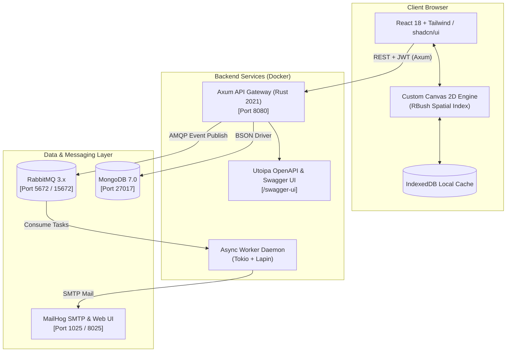

<p align="center">
  <a href="#readme">
    
    <br />
    
  </a>
</p>

<p align="center">
  <strong>The open-source infinite canvas whiteboard crafted specifically for software architecture & system design.</strong>
</p>

<p align="center">
  <a href="https://github.com/luis-felipe/drawit/actions"></a>
  <a href="https://www.rust-lang.org/"></a>
  <a href="https://react.dev/"></a>
  <a href="https://www.mongodb.com/"></a>
  <a href="https://www.rabbitmq.com/"></a>
  <a href="https://swagger.io/"></a>
  <a href="LICENSE"></a>
</p>

<p align="center">
  <a href="#-key-features">Key Features</a> •
  <a href="#-why-drawit">Why DrawIt?</a> •
  <a href="#-quickstart">Quickstart</a> •
  <a href="#-system-architecture">Architecture</a> •
  <a href="#-local-development">Development</a> •
  <a href="#-api-documentation">API Docs</a> •
  <a href="#-roadmap">Roadmap</a> •
  <a href="#-contributing">Contributing</a>
</p>

---

## 💡 Why DrawIt?

Generic whiteboard tools (Excalidraw, Miro, Figma) are great for freeform sketching, but they fall short when you are designing distributed systems:

- ❌ **Tiring & Repetitive:** You spend minutes drawing generic cylinders for databases, boxes for microservices, and searching for icons from scratch every single time.
- ❌ **Fragile Connectors:** Arrows break or detach when elements are moved or resized, requiring manual reconnection.
- ❌ **Disorganized Workspaces:** Boards pile up in a flat, unsearchable list without categories, tags, or folder hierarchy.
- ❌ **Vendor Lock-in & Enterprise Paywalls:** Basic organizational features like folders and exports are locked behind expensive SaaS subscriptions.

**DrawIt solves this.** It gives engineers, software architects, and tech leads a distraction-free, self-hostable whiteboard with **first-class system design stencils**, **magnetic arrow bindings**, and **structured board organization** out of the box.

<p align="center">
  
</p>

---

## ✨ Key Features

### ⚡ Infinite Canvas Engine (Canvas 2D + Spatial Indexing)
- **High Frame-Rate 60fps Performance:** Proprietary Canvas 2D engine decoupled from React re-renders for buttery-smooth interaction.
- **R-Tree Spatial Partitioning:** Powered by `rbush` for instant hit-testing, selection, and rendering optimization on diagrams with thousands of elements.
- **Fluid Navigation:** Intuitive mouse wheel zoom (**10% to 800%**) anchored to cursor, Space+Drag or middle-click panning, and fit-to-screen shortcuts.
- **Freehand Smoothing:** Natural pen strokes with pressure simulation powered by `perfect-freehand`.

### 🧩 Native IT & System Architecture Stencils
- Instant vector stencils for modern architectures across multiple domains:
  - **Clients:** Browser, Mobile App, Tablet, Desktop, Terminal / CLI.
  - **Backend & Services:** API Gateway, Microservice, Serverless / Lambda, Background Worker, Load Balancer.
  - **Data Stores:** Relational DB (SQL), Document DB (NoSQL), In-Memory Cache (Redis), Data Lake, Object Storage (S3).
  - **Messaging & Event Streaming:** Message Broker (RabbitMQ), Kafka / Event Stream, Pub/Sub, Queue.
  - **Infrastructure & Cloud:** Docker Container, Kubernetes Pod, Cloud VPC, Firewall / WAF, CDN.
- Fully customizable: adjust stroke colors, background fills, border styles, opacity, and rotation.

### 🧲 Dynamic Arrow Bindings & Magnetic Anchors
- Arrows automatically snap to element anchor ports (North, South, East, West).
- Moving, resizing, or rotating connected stencils updates connector lines in real time without manual re-routing.
- Customizable arrowheads (solid, open, bidirectional, perpendicular).

### 📁 First-Class Workspace & Board Organization
- **Hierarchical Groups:** Categorize diagrams into folders/projects (e.g., *Core Backend*, *Payment Gateway*, *Auth Migration*).
- **Tagging & Instant Filtering:** Multi-tag system with fuzzy search across titles and tags.
- **Favorites & Recent Views:** Pin critical system designs for single-click access.
- **Soft-Delete Lifecycle:** Dedicated Trash view with instant restore or safe permanent purge.

### 💾 Offline-First Autosave & Conflict Prevention
- **Background Sync:** Transparent autosave with visual status indicators (*Saved*, *Saving*, *Offline*).
- **IndexedDB Fallback:** Client-side caching via `idb` ensures no work is lost during connectivity drops.
- **Optimistic Concurrency:** Smart revision tracking detects and resolves concurrent editing conflicts.

### 🎨 Pixel-Perfect Vector & Raster Export
- Export diagrams or selected sub-regions to **PNG** (retina 2x/3x scaling) and **vector SVG**.
- Export and import boards as versioned **JSON** schemas for backup, migration, or sharing via Git.

### 🦀 Enterprise-Grade Rust Backend
- High-concurrency async REST API powered by **Axum**, **Tokio**, and **MongoDB**.
- **RabbitMQ Message Queue:** Decoupled asynchronous worker for event processing and transactional email delivery.
- **Bulletproof Auth:** Secure Argon2id password hashing, JWT authentication, and automated refresh token rotation.
- **Built-in Email Verification:** SMTP workflow connected to MailHog for seamless local development.

---

## 🏗️ System Architecture

DrawIt is designed with a modern decoupled architecture:



### Tech Stack

| Layer | Technologies | Key Highlights |
| :--- | :--- | :--- |
| **Frontend** | React 18, TypeScript, Vite, Tailwind CSS | shadcn/ui, Radix UI primitives, Zustand state management |
| **Canvas Engine**| HTML5 Canvas 2D, `rbush`, `perfect-freehand` | R-Tree spatial indexing, 60fps pan/zoom, dynamic anchor bindings |
| **Backend API** | Rust 2021, Axum, Tokio, Tower | High performance, memory-safe, Argon2id, JWT rotation |
| **Database** | MongoDB 7.0 | Document storage for boards, elements, groups, and users |
| **Queue & Worker**| RabbitMQ (Lapin), Tokio background worker | Asynchronous email dispatch, event processing |
| **Documentation**| OpenAPI 3.0 via Utoipa & Swagger UI | Interactive API explorer at `/swagger-ui` |
| **DevOps** | Docker, Docker Compose, Multi-stage builds | Single command local setup with healthy service orchestration |

---

## 🚀 Quickstart

Get DrawIt running locally in under **2 minutes** using Docker Compose.

### Prerequisites
- [Docker Desktop](https://www.docker.com/products/docker-desktop/) (or Docker Engine 24+ & Docker Compose v2)
- Git

### 1. Clone the repository
```bash
git clone https://github.com/luiz0ar/drawit.git
cd drawit
```

### 2. Configure Environment
A pre-configured environment template is ready to use:
```bash
cp .env.example .env
```

### 3. Spin up the containers
```bash
docker compose up --build
```

That's it! Once containers report healthy, open the services in your browser:

| Service | URL | Default Credentials / Notes |
| :--- | :--- | :--- |
| **DrawIt Web Application** | [http://localhost:3000](http://localhost:3000) | Register any user (verification link sent to MailHog) |
| **Backend REST API** | [http://localhost:8080](http://localhost:8080) | Health endpoint: `http://localhost:8080/health` |
| **Interactive Swagger UI** | [http://localhost:8080/swagger-ui](http://localhost:8080/swagger-ui) | Full API schema & direct test runner |
| **MailHog (Email Sandbox)** | [http://localhost:8025](http://localhost:8025) | Inspect verification emails and tokens |
| **RabbitMQ Management** | [http://localhost:15672](http://localhost:15672) | Username: `guest` \| Password: `guest` |

---

## 💻 Local Development

If you prefer developing directly on your host machine without Docker for the application code:

### 1. Start Support Infrastructure
Run MongoDB, RabbitMQ, and MailHog via Docker Compose:
```bash
docker compose up -d mongo rabbitmq mailhog
```

### 2. Start Backend (Rust)
Prerequisites: [Rust 1.78+](https://www.rust-lang.org/tools/install)
```bash
cd api

# Run migrations & start API server with debug logging
cargo run
```
To run backend automated test suites:
```bash
cargo test
```

### 3. Start Frontend (React + Vite)
Prerequisites: [Node.js 18+](https://nodejs.org/) & npm
```bash
cd web

# Install dependencies
npm install

# Start Vite dev server with hot module replacement (HMR)
npm run dev
```
To execute frontend unit and integration tests:
```bash
npm run test
```

---

## ⌨️ Keyboard Shortcuts

Speed up your architecture diagramming with power-user hotkeys:

| Action | Shortcut (Mac) | Shortcut (Windows/Linux) |
| :--- | :--- | :--- |
| **Command Palette** | `Cmd + K` | `Ctrl + K` |
| **Selection Tool** | `V` | `V` |
| **Hand Tool (Pan Canvas)** | `H` or `Space + Drag` | `H` or `Space + Drag` |
| **Zoom In / Out** | `Cmd + +` / `Cmd + -` (or Wheel) | `Ctrl + +` / `Ctrl + -` (or Wheel) |
| **Reset Zoom (100%)** | `Cmd + 0` | `Ctrl + 0` |
| **Undo / Redo** | `Cmd + Z` / `Cmd + Shift + Z` | `Ctrl + Z` / `Ctrl + Shift + Z` |
| **Duplicate Selected** | `Cmd + D` | `Ctrl + D` |
| **Delete Selected** | `Backspace` / `Delete` | `Delete` |
| **Select All Elements** | `Cmd + A` | `Ctrl + A` |
| **Toggle Grid** | `Cmd + '` | `Ctrl + '` |

---

## 📚 API Documentation

DrawIt features automated OpenAPI 3.0 documentation using [Utoipa](https://github.com/juhaku/utoipa).

Explore and test all endpoints directly in the interactive Swagger UI:
👉 **[http://localhost:8080/swagger-ui](http://localhost:8080/swagger-ui)**

### Core Endpoints Overview

- `POST /api/auth/register` — Create account and trigger asynchronous email verification.
- `POST /api/auth/login` — Authenticate user and issue JWT access & refresh tokens.
- `POST /api/auth/refresh` — Rotate refresh tokens and receive fresh access tokens.
- `GET  /api/boards` — List user boards with pagination, group filtering, and tag search.
- `POST /api/boards` — Create a new whiteboard scene.
- `GET  /api/boards/:id` — Fetch complete board scene, elements, and viewport state.
- `PUT  /api/boards/:id` — Save scene modifications with optimistic version validation.
- `POST /api/boards/:id/trash` — Move board to soft-delete trash bin.
- `GET  /api/groups` — Manage board workspace folders/groups.

---

## 🗺️ Roadmap

- [x] **P0: Core MVP (Current)**
  - [x] Custom Canvas 2D infinite engine with smooth zoom & pan
  - [x] System architecture component stencils (Databases, Servers, Queues, Clients)
  - [x] Dynamic arrow bindings with anchor tracking
  - [x] Full board organization: Folders, tags, search, and trash lifecycle
  - [x] Local autosave with IndexedDB fallback
  - [x] Rust (Axum) + MongoDB + RabbitMQ backend
  - [x] Docker Compose multi-container development environment

- [ ] **P1: Next Milestone**
  - [ ] Orthogonal and curved routing for arrows
  - [ ] Multi-element grouping and layer ordering (Bring to Front, Send to Back)
  - [ ] Pre-designed system design templates (Microservices, Event-Driven, 3-Tier Web)
  - [ ] Board version history & snapshot rollback
  - [ ] Thumbnail generation on board listing

- [ ] **P2: Future Horizon**
  - [ ] Real-time multi-user collaboration using CRDTs & WebSockets
  - [ ] Full-text search inside element notes and diagram text
  - [ ] Third-party format import/export (Excalidraw, Draw.io)
  - [ ] Production Helm charts & cloud deploy scripts (Kubernetes, AWS ECS)

---

## 🤝 Contributing

Contributions are what make the open-source community an incredible place to learn, inspire, and create. Any contributions you make are **greatly appreciated**!

1. **Fork the Project**
2. **Create your Feature Branch** (`git checkout -b feature/AmazingStencil`)
3. **Commit your Changes** (`git commit -m 'feat: add Kafka connector stencil'`)
4. **Push to the Branch** (`git push origin feature/AmazingStencil`)
5. **Open a Pull Request**

Please make sure tests pass before opening a PR:
```bash
# Backend tests
cd api && cargo test

# Frontend tests & linting
cd web && npm run test && npm run lint
```

---

## 📄 License

Distributed under the **MIT License**. See [`LICENSE`](LICENSE) for more information.

---

<p align="center">
  Crafted with care for developers and software architects worldwide.
  <br />
  <sub>If you find DrawIt useful, don't forget to star ⭐ the repository!</sub>
</p>

